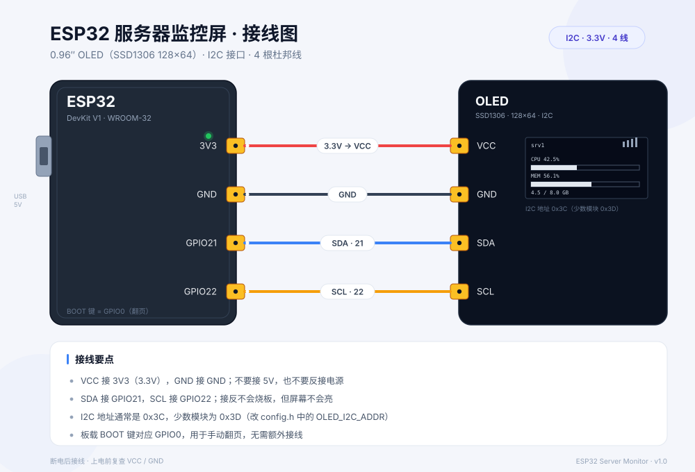
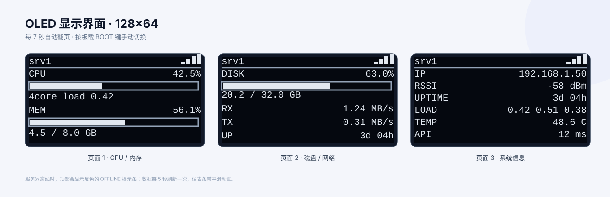

# ESP32 服务器监控屏

用一块 **ESP32** + 一块 **0.96″ OLED**，做一个放在桌面的小屏幕，实时显示服务器的
CPU、内存、磁盘、网速、负载、温度和在线状态。

```
┌──────────────┐    WiFi / HTTP     ┌──────────────┐
│  服务器       │  ───────────────►  │   ESP32      │
│  agent :8787 │   JSON / 每 5 秒    │              │
└──────────────┘                    └──────┬───────┘
                                           │ I2C
                                    ┌──────▼───────┐
                                    │  OLED 128×64 │
                                    └──────────────┘
```

* **服务器端**：一个 Python 脚本，只依赖标准库，读 `/proc` 暴露一个 JSON 接口
* **ESP32**：定时拉取 JSON，用 3 个页面轮流显示，掉线有提示
* **额外成本**：0 元。翻页用板载 BOOT 键，不需要加按钮



---

## 1. 物料清单

| 数量 | 物料 | 说明 |
|:---:|------|------|
| 1 | ESP32 开发板 | DevKit V1 / WROOM-32（30 针、38 针都行），带 USB 线 |
| 1 | 0.96″ OLED 模块 | **SSD1306** 驱动，128×64，**I2C 4 针**（VCC/GND/SDA/SCL） |
| 4 | 杜邦线 | 母对母，建议 ≤ 20 cm |

> 买屏时认准 **I2C 4 针** 版本。7 针 SPI 版接线和代码都不一样；
> SH1106 驱动虽然长得一样，但需要换用 U8g2 库。

---

## 2. 接线（先断电再接线）

| OLED 引脚 | ESP32 引脚 | 线色（图中） | 说明 |
|:---:|:---:|:---:|------|
| VCC | **3V3** | 红 | 3.3V 供电，**不要接 5V 或 VIN** |
| GND | **GND** | 黑 | 共地 |
| SDA | **GPIO21** | 蓝 | I2C 数据 |
| SCL | **GPIO22** | 黄 | I2C 时钟 |



接线要点：

1. 模块丝印可能是 `SCL/SCK`、`SDA/SDI`，对应关系不变。
2. VCC/GND 接反可能烧屏，接之前多看一眼。
3. 线太长（> 30 cm）容易出现花屏、随机重启，尽量短。
4. 接好后先跑一遍 [`docs/i2c_scan`](docs/i2c_scan/i2c_scan.ino)：串口打印
   `found device at 0x3C` 就说明屏和线都没问题。

---

## 3. 服务端（Linux）

### 3.1 上传并运行

在**你自己的电脑**上（项目根目录）：

```bash
scp server-agent/server_monitor_agent.py user@服务器IP:/tmp/
```

登录服务器：

```bash
sudo mkdir -p /opt/server-monitor
sudo cp /tmp/server_monitor_agent.py /opt/server-monitor/
sudo chmod +x /opt/server-monitor/server_monitor_agent.py

# 建一个专用低权限用户
sudo useradd --system --user-group --no-create-home --shell /usr/sbin/nologin monitor 2>/dev/null || true
```

前台试跑一下：

```bash
python3 /opt/server-monitor/server_monitor_agent.py --port 8787 --token "s3cret-token"
```

另开一个终端验证：

```bash
curl -H "X-Token: s3cret-token" http://127.0.0.1:8787/metrics
```

正常会看到类似：

```json
{"agent":"1.0.0","ts":1792985273,"host":"srv1","kernel":"6.8.0","uptime":273602,
 "cores":4,"load":[0.45,0.52,0.61],"cpu":49.8,
 "mem":{"total_kb":8388608,"used_kb":4743852,"percent":56.6},
 "disk":{"total_kb":33554432,"used_kb":21154251,"percent":63.0},
 "net":{"rx_bytes":5103700,"tx_bytes":1871342},"temp_c":48.5}
```

### 3.2 开机自启

```bash
sudo cp server-agent/server-monitor.service /etc/systemd/system/
sudo nano /etc/systemd/system/server-monitor.service   # 改 --token，务必和固件一致
sudo systemctl daemon-reload
sudo systemctl enable --now server-monitor

systemctl status server-monitor        # 看状态
journalctl -u server-monitor -f        # 看日志
```

### 3.3 防火墙

只放行局域网，不要暴露到公网：

```bash
# 假设局域网是 192.168.1.0/24
sudo ufw allow from 192.168.1.0/24 to any port 8787 proto tcp
```

如果要在外网看，用 Tailscale / WireGuard 组网，别把 8787 端口直接映射出去。

### 3.4 没有 Linux 服务器？先用 demo 模式

`--demo` 会生成假数据，可以先把屏幕调通：

```bash
python3 server-agent/server_monitor_agent.py --demo --port 8787 --token "s3cret-token"
```

macOS 上同样能跑（真实模式需要 `/proc`，只有 Linux 有）。

### 3.5 接口说明

| 接口 | 说明 |
|------|------|
| `GET /metrics` | 指标 JSON（ESP32 用这个） |
| `GET /health` | 存活检查 |
| 鉴权 | 请求头 `X-Token: <token>`，或 `?token=<token>`；不设 token 则不校验 |

常用参数：`--bind 0.0.0.0`、`--port 8787`、`--token xxx`、`--interval 1.0`、`--quiet`、`--once`。

---

## 4. 固件

### 4.1 用 PlatformIO（推荐）

```bash
cd firmware
# 1) 改 src/secrets.h：WiFi、服务器地址、token
pio run                 # 编译
pio run -t upload       # 烧录
pio device monitor      # 串口日志 115200
```

### 4.2 用 Arduino IDE

1. 开发板选择 **ESP32 Dev Module**（需要先装 esp32 支持包）。
2. 库管理器安装：
   * `Adafruit SSD1306`
   * `Adafruit GFX Library`
   * `ArduinoJson`（**v7**）
3. 新建文件夹 `esp32_server_monitor`，把 `firmware/src/main.cpp` 改名为
   `esp32_server_monitor.ino` 放进去，再把 `config.h`、`secrets.h` 一起复制进去。
4. 上传。

### 4.3 需要改的只有 `firmware/src/secrets.h`

```cpp
#define WIFI_SSID     "家里的WiFi"        // 注意：ESP32 只支持 2.4GHz
#define WIFI_PASSWORD "密码"
#define SERVER_URL    "http://192.168.1.100:8787/metrics"   // 服务器 IP 建议在路由器里固定
#define API_TOKEN     "s3cret-token"      // 与服务端 --token 完全一致
```

`config.h` 里可以改引脚、刷新间隔、翻页间隔：

| 宏 | 默认 | 说明 |
|---|---|---|
| `PIN_I2C_SDA` / `PIN_I2C_SCL` | 21 / 22 | I2C 引脚 |
| `OLED_I2C_ADDR` | 0x3C | 屏幕不亮可试 0x3D |
| `FETCH_INTERVAL_MS` | 5000 | 拉数据间隔 |
| `PAGE_INTERVAL_MS` | 7000 | 自动翻页间隔 |
| `STALE_AFTER_MS` | 15000 | 多久没数据算离线 |
| `ENABLE_BUTTON` | 1 | 是否启用 BOOT 键翻页 |

---

## 5. 界面说明

三个页面，每 7 秒自动切换，**按板载 BOOT 键**可手动翻页（按下会重新计时）。

**页面 1：CPU / 内存**

```
srv1                    ▂▄▆█
──────────────────────────────
CPU                     42.5%
[████████░░░░░░░░░░░░░░░░░░░]
4core  load 0.42
MEM                     56.1%
[███████████░░░░░░░░░░░░░░░]
3.9 / 8.0 GB
```

**页面 2：磁盘 / 网络**

```
DISK                    63.0%
[████████████░░░░░░░░░░░░░]
20.2 / 32.0 GB
RX                  1.24 MB/s
TX                  0.31 MB/s
UP                     3d 04h
```

**页面 3：系统信息**

```
IP              192.168.1.50
RSSI                 -58 dBm
UPTIME                3d 04h
LOAD          0.42 0.51 0.38
TEMP                  48.6 C
API                    12 ms
```

* 右上角的信号格是 ESP32 自己的 WiFi 信号，不是服务器的。
* 服务器超过 15 秒没响应，顶部会变成反色的 `OFFLINE` 提示条，数据保留最后一次的值。
* 仪表条做了平滑动画，数值跳变时不会突兀。

---

## 6. 常见问题

**屏幕全黑**
1. 先确认 VCC 接的是 `3V3` 而不是 `5V/VIN`；
2. 运行 `docs/i2c_scan`，能扫到 `0x3C` 说明硬件正常；
3. 扫到的是 `0x3D`，就把 `config.h` 里 `OLED_I2C_ADDR` 改成 `0x3D`；
4. 扫不到设备：换杜邦线、检查 SDA/SCL 是否接反、换一块屏试。

**花屏、闪烁、偶尔重启**
* 杜邦线过长或接触不良，换短线；
* 把 `Wire.setClock(400000)` 改成 `100000`；
* 用质量差的数据线供电，电压会掉到 4.5V 以下，换线或换 USB 口。

**首次编译卡在 `Downloading toolchain...`**
* PlatformIO 的依赖包托管在 GitHub，国内网络容易卡住；
* 给终端挂代理后重试：`export HTTPS_PROXY=http://127.0.0.1:7890`（端口按你的代理改），
  然后 `pio run`；依赖装好后会缓存在 `~/.platformio`，以后不用再下载；
* 或者直接在能访问 GitHub 的网络环境编译一次，把 `~/.platformio` 整个目录拷过来。

**上传失败：`Failed to connect to ESP32`**
* 按住 BOOT 键再点一下 EN（或重新插拔），松开 BOOT 再上传；
* 换成能传数据的 USB 线（有些线只能充电）；
* macOS 需要装 CH340 / CP210x 驱动；
* 把 `upload_speed` 从 `921600` 降到 `115200`。

**WiFi 连不上**
* ESP32 **只支持 2.4GHz**，5GHz 的 SSID 连不上；
* 公司/校园网有认证页面，ESP32 用不了，建议开手机热点或访客网络；
* 检查 SSID 大小写和隐藏网络设置。

**串口一直打印 `[http] ... -> -1` 或屏幕 `WAITING FOR SERVER`**
* 先用电脑 `curl` 测试服务器地址通不通；
* `SERVER_URL` 的 IP 写的是不是服务器的**局域网** IP；
* 防火墙是否放行 8787；
* 服务器 IP 是 DHCP 分配的，重启后变了 —— 在路由器里绑定静态 IP。

**返回 401**
* `API_TOKEN` 和服务端 `--token` 不一致（注意空格、引号）；
* 服务端没设 token 时，固件里请把 `API_TOKEN` 设为 `""`。

**网速一开始是 0**
* 网速需要两次采样做差，第一次请求没有基准值，等 5 秒后正常。

**主机名显示成方块**
* OLED 默认字体只有 ASCII，主机名改成英文（`hostnamectl set-hostname srv1`）。

---

## 7. 还可以怎么玩

* **多服务器**：把 `SERVER_URL` 换成数组，页面里循环请求，顶部显示不同主机名
* **告警**：CPU > 90% 时让屏幕闪烁，或加一个无源蜂鸣器（GPIO 接三极管）
* **Web 配置页**：用 `WiFiManager` 免改代码配 WiFi
* **外壳**：3D 打印一个斜面支架，屏幕稍微朝上更好看
* **MQTT**：把数据同时发到 Home Assistant，做长期曲线

---

## 目录结构

```
esp32-server-monitor/
├── README.md
├── docs/
│   ├── wiring.svg              # 接线图
│   ├── screens.svg             # 界面预览
│   └── i2c_scan/i2c_scan.ino   # I2C 地址扫描（排障用）
├── firmware/
│   ├── platformio.ini
│   └── src/
│       ├── main.cpp            # 固件主程序
│       ├── config.h            # 引脚 / 时序
│       ├── secrets.h           # WiFi / 服务器地址 / token（别提交到 git）
│       └── secrets.h.example
└── server-agent/
    ├── server_monitor_agent.py # 服务器端采集接口
    └── server-monitor.service  # systemd 服务
```

## 许可

MIT，随便改随便用。
